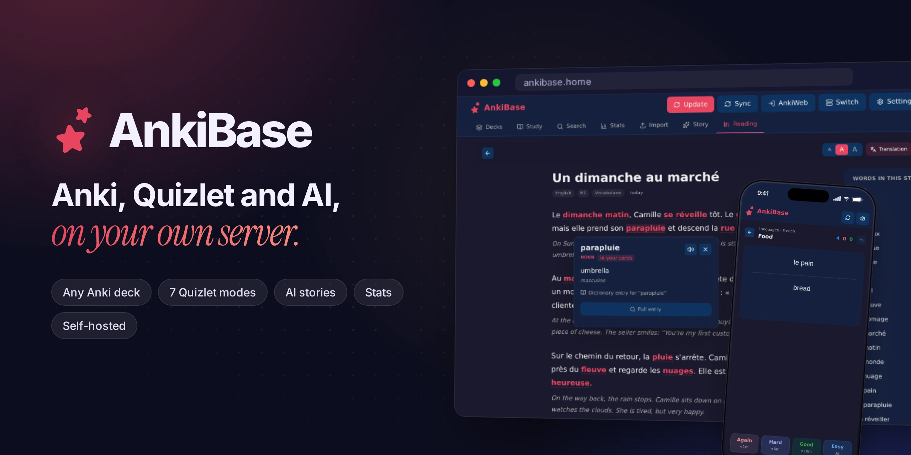
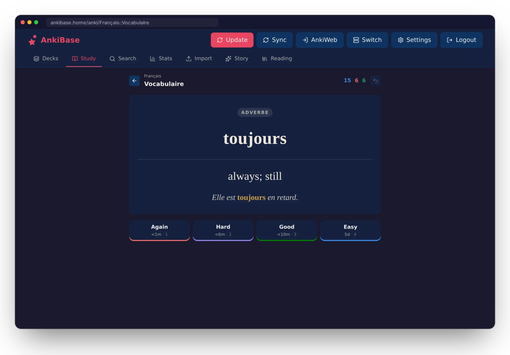
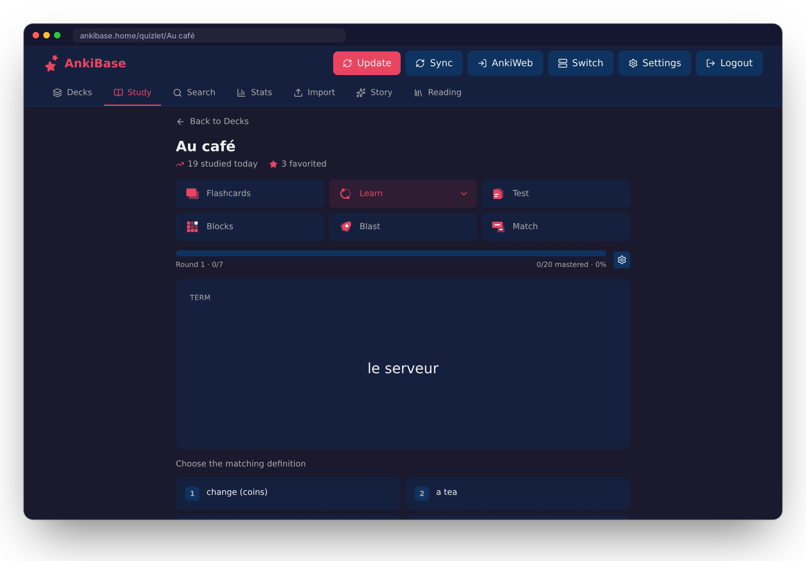
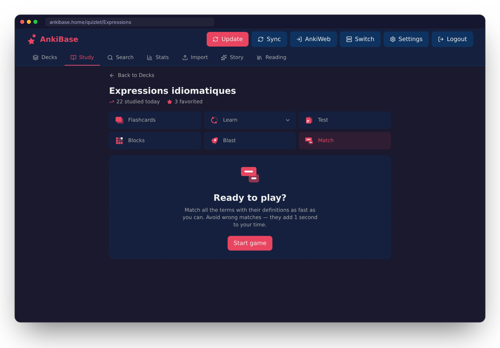
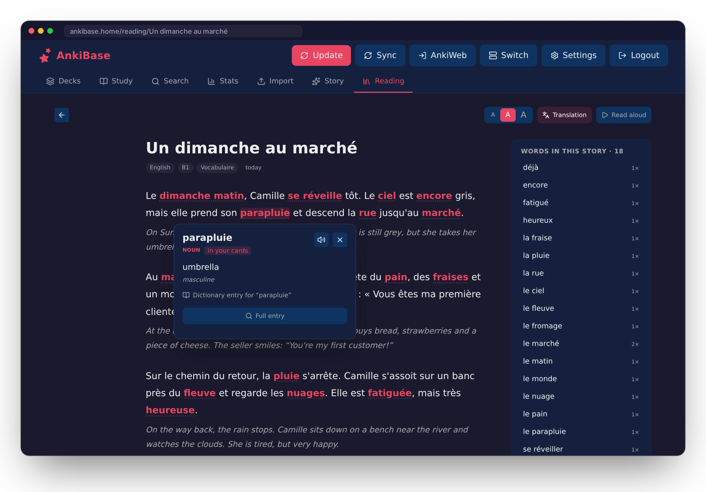
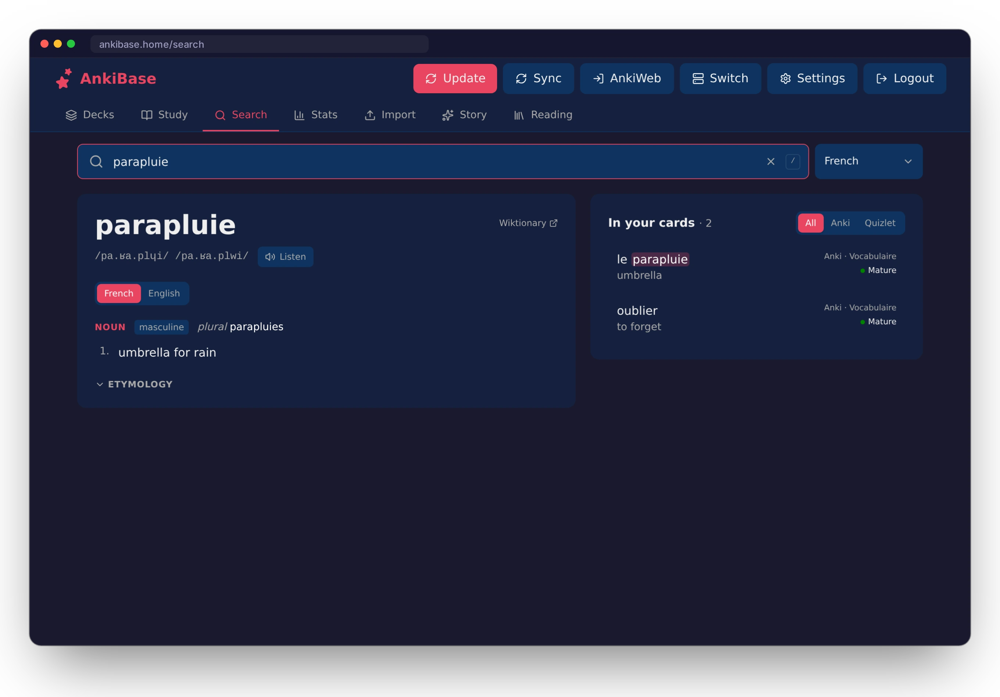
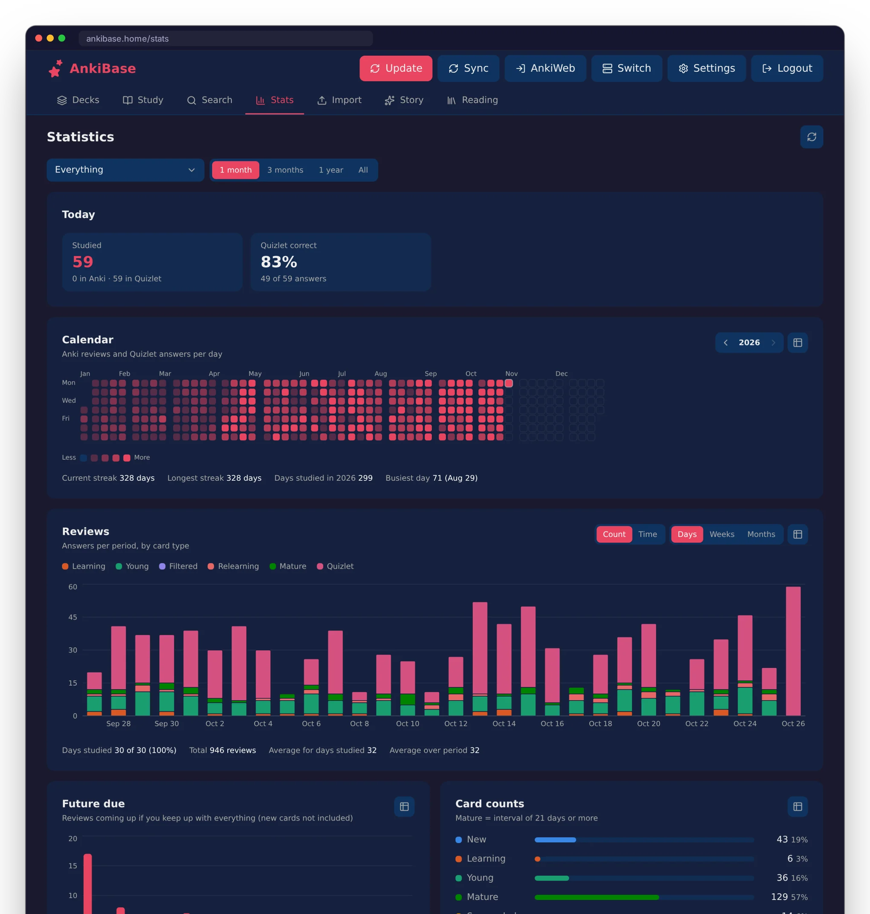
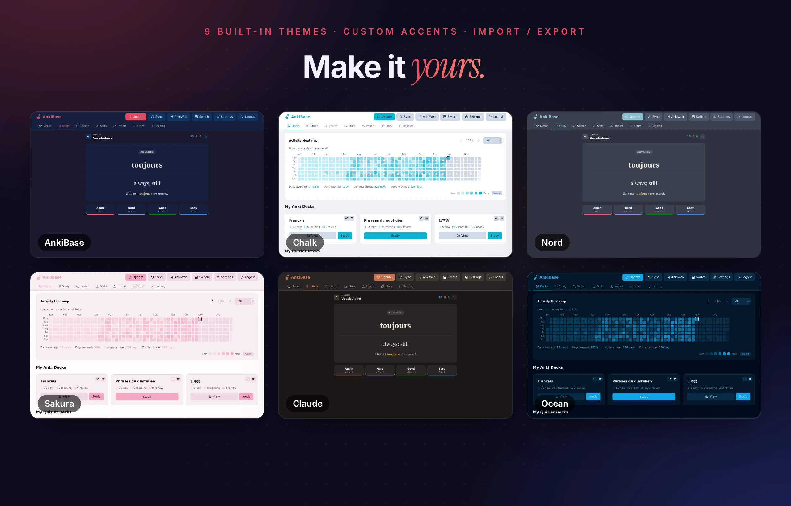
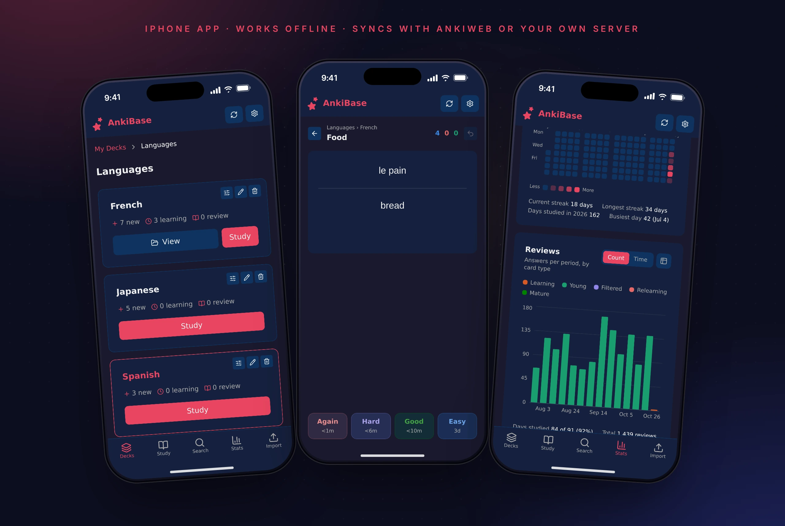
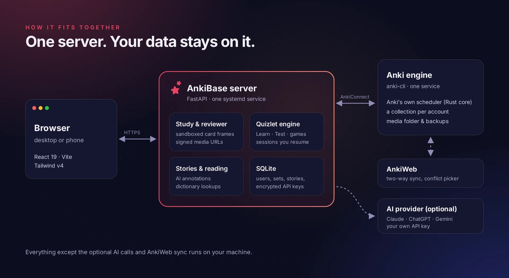

<div align="center">



<br>

[](https://github.com/Macro002/AnkiBase/stargazers)
[](LICENSE)
[](https://github.com/Macro002/AnkiBase/commits/main)
[](https://macro002.github.io/AnkiBase/)

**[Watch the demo](#-see-it-in-action)** · **[Install](#-install)** · **[Features](#-features)** · **[Docs](https://macro002.github.io/AnkiBase/)** · **[API](https://macro002.github.io/AnkiBase/api-reference.html)**

</div>

AnkiBase is a self-hosted web app for language learners. It runs your **real Anki collection** in the browser, plays **Quizlet sets** in every Quizlet mode, and uses **AI** to turn the words you're learning into short stories you can read with tap-to-translate. It runs on your own server, so your decks stay with you.

## 🎬 See it in action

<div align="center">
  <a href="https://github.com/Macro002/AnkiBase/blob/main/docs/public/media/ankibase-demo.mp4">
    
  </a>
  <sub>Click for the full 1080p video (46 s).</sub>
</div>

## ✨ Features

### 🃏 Study any Anki deck, the way Anki shows it



- **Anki's own reviewer:** card order, daily limits, learning steps and burying all come from Anki itself. Each card takes about one fast call, so studying stays quick on big collections.
- **Every note type renders properly:** your templates' HTML and CSS run in a sandboxed frame with night mode (and day mode on light themes), images, audio buttons, cloze, type-in answers, MathJax and card scripts.
- Keyboard first: <kbd>Space</kbd> reveals, <kbd>1</kbd>–<kbd>4</kbd> answer, <kbd>Ctrl</kbd>+<kbd>Z</kbd> undoes, <kbd>R</kbd> replays audio. The answer buttons show the next intervals.
- Two-way **AnkiWeb sync** with a conflict picker, `.apkg` import, and deck management.

### 🧩 Quizlet sets, fully playable

<table>
<tr>
<td width="50%"></td>
<td width="50%"></td>
</tr>
</table>

Import a set from its link and study it in **Flashcards, Learn, Write, Test, Match, Blast and Blocks**. Learn works like Quizlet's, with goals, rounds, multiple choice followed by written answers, and mastery tracking. Sessions save as you go, and the **Study hub** lists every unfinished one so you can pick it back up.

### 📖 AI stories built from your words



- Pick a deck or set. **Smart pick** favours words you're still learning: for Anki it uses card states, and for Quizlet it uses starred and often-missed terms. Then **Claude, ChatGPT or Gemini** writes a story at your CEFR level, with optional translations.
- In **Reading**, every word is already annotated with its dictionary form, part of speech, meaning in context and grammar notes, so lookups are instant. Highlight a sentence and ask the AI to **explain** it.
- Words from your cards are highlighted, along with their inflected forms.

### 🔎 Dictionary search across your cards



Search works like a dictionary, with pronunciation, senses, gender, plural and etymology. Next to it is **"In your cards"**: every Anki note and Quizlet term that contains the word, along with its state.

### 📊 Anki-grade stats, for both



A calendar heatmap, reviews over time, future due, card counts, intervals, ease, an hourly breakdown, answer buttons, true retention and cards added. Each view can be scoped to everything, one Anki deck or one Quizlet set. Quizlet gets its own **terms to work on** table.

### 🎨 Make it yours



Nine built-in themes, custom accent and base colours with a live preview, and theme import/export. Admins can set the server-wide default. Sliders, toggles and panels move with springy, velocity-aware motion.

### 📱 Feels native on your phone



Bottom tab bar, safe-area aware layouts, large touch targets and a full-width answer bar.

### 🏠 Built to self-host

- **Multi-user:** an admin panel and per-user permissions. Each Anki account gets its **own collection, media and AnkiWeb login**.
- **One-line install** with optional nginx and Let's Encrypt, and **in-app updates** with one click.
- API keys are stored encrypted, and the AI is optional: everything else works without it.

## 🧭 How it fits together



| Layer | Tech |
|---|---|
| Frontend | React 19, TypeScript, Vite, Tailwind CSS v4 |
| Backend | FastAPI + Uvicorn, SQLite |
| Anki engine | [anki-cli](https://github.com/Macro002/anki-cli): Anki's own engine as one small service, a collection per account. No Docker, no Anki Desktop |
| AI (optional) | Anthropic Claude, OpenAI, Google Gemini (bring your own key) |

## 🚀 Install

You need a Debian-based server (Debian 12/13 or Ubuntu 22.04+) with root access.

```bash
curl -fsSL https://raw.githubusercontent.com/Macro002/AnkiBase/main/install.sh | sudo bash
```

The installer:

1. Installs Node.js 20 and Python if they're missing
2. Builds the frontend
3. Picks a free port, starting at 8000
4. Generates the secret and encryption keys
5. Creates the `ankibase` systemd service (and `ankibase-anki` for the Anki engine)
6. Optionally sets up nginx with a Let's Encrypt certificate

Open the address it prints. A setup wizard creates your admin account and your first Anki account.

### Updating

Click **Update** in the header when it lights up, or run:

```bash
curl -fsSL https://raw.githubusercontent.com/Macro002/AnkiBase/main/install.sh | sudo bash -s -- --update
```

### Handy commands

```bash
journalctl -u ankibase -f      # live logs
systemctl restart ankibase     # restart
systemctl status ankibase      # status
journalctl -u ankibase-anki -f # Anki engine logs
```

Collections live in `/opt/ankibase/anki-data/<account>/` (Anki's usual layout: `collection.anki2`,
`collection.media/`, `backups/`), with a backup every hour.

### Coming from the Docker version

Older versions ran one headless Anki container per account. The first start after updating
moves every account to the new engine on its own: it stops each container, copies the
collection and media into `/opt/ankibase/anki-data/`, carries the AnkiWeb login over and
removes the container. The Docker volumes are left untouched, so delete them yourself once
you're happy (`docker volume ls`, `docker volume rm …`).

## 🛠️ Development

```bash
# backend (http://localhost:8000)
cd backend
python3 -m venv venv && source venv/bin/activate
pip install -r requirements.txt
uvicorn main:app --reload

# frontend (http://localhost:5173, proxies /api to :8000)
cd frontend
npm install
npm run dev
```

Before opening a PR, run `npm run lint` and `npm run build` in `frontend/`. The docs site lives in [`docs/`](docs) (Nextra) and deploys to GitHub Pages on every push to `main`.

<details>
<summary><b>Project layout</b></summary>

```
backend/
  main.py              FastAPI app and API routes
  review.py            studying through Anki's reviewer, signed media URLs
  stats_engine.py      Anki + Quizlet statistics
  story_generator.py   AI providers, stories, reading annotations
  dictionary.py        dictionary lookups
  database.py          SQLite: users, accounts, Quizlet sets, sessions, stories
frontend/src/
  components/          Decks, Study, Quizlet modes, Story, Reading, Search, Stats…
  components/study/    sandboxed Anki card frame
  components/quizlet/  Learn, Test, Match, Blast, Blocks + shared UI
  pages/Settings.tsx   themes, language, account, AI, users
docs/                  documentation site (Nextra)
install.sh             installer / updater
```

</details>

## 📄 License

[MIT](LICENSE). AnkiBase is an independent project and isn't affiliated with Anki, AnkiWeb or Quizlet.
